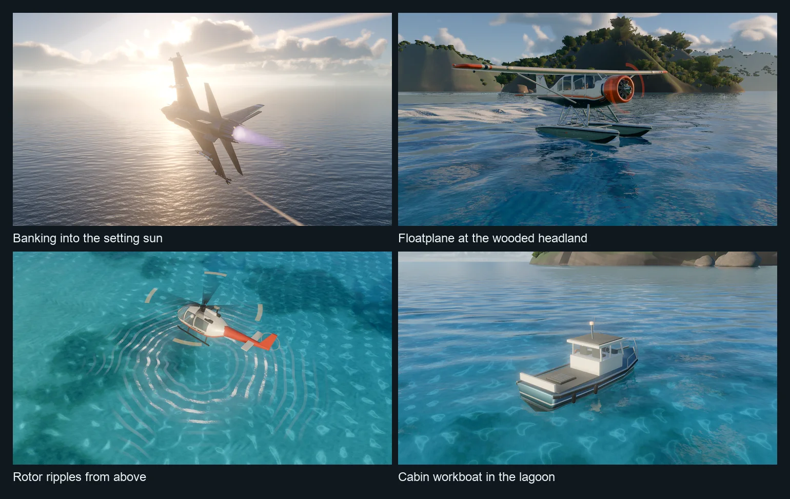

# Lumina Physics

Give your coding agent the physics and shaders to build an ocean, a rain-soaked street, or a storm rolling across a game world.<br>
Wind, pressure, heat, and wetness pass between systems, so a helicopter can bend the rain, whip a flag, and push spray across the water in the same scene.

   [](LICENSE)

## Quick Start

**Install** the skill globally, then open your game project in your coding agent and try a prompt below.

```sh
npx skills add LuminaBench/lumina-physics -g
```

**Update** your global skills.

```sh
npx skills update -g
```

**Remove** Lumina Physics.

```sh
npx skills remove lumina-physics -g
```

## From the showcase

[](docs/gallery/README.md)

[Browse the render gallery](docs/gallery/README.md) · [Explore the playable coastlines](specs/27-coastal-worlds.md) · [Compare art directions and seasons](specs/releases/v1.0.0-fields.md)

## Bring it into your game

Ask your agent to start with a player-visible change, such as the spray from one tire crossing a gutter. The selective installer can preview the files it needs, preserve your earlier module imports and flag edits in game-owned files before it writes an upgrade.

Your game can supply its own terrain, trees, materials, camera and controls. [Author a tree, flower, biome or shader](specs/26-land-authoring.md) · [Explore a project-owned valley](examples/brindle-reach/garden) · [Drive across a breakable salt flat](examples/dry-lake/README.md) · [Follow runoff through a low-water crossing](specs/28-runoff-crossing.md)

## What You Can Ask Your AI

- “Add a coastal flight scene to my game. Give the ocean a long swell, throw spray behind low-flying aircraft, and catch the setting sun on the waves.”
- “Make a shower roll across this driving level. Fill puddles, let the tires lose grip in standing water, and leave wet tracks as the car reaches dry asphalt.”
- “Make an explosion in the courtyard shake the flags, shatter nearby windows, and scatter debris. Give me a trigger so I can replay it while tuning the scene.”

## What's Included

| System | What you can build |
| --- | --- |
| Water | Oceans, buoyant boats, wakes, tsunamis, rivers, waterfalls, and underwater views |
| Weather | Layered volumetric clouds, moving shadows, rain, lightning, and changes in daylight |
| Aerodynamics | Jet exhaust, wingtip vapor, downwash, sonic-boom events, and helicopter rotor wash |
| Roads | Puddles, aquaplaning, tire spray, and per-wheel wet or muddy tracks |
| Fire and heat | Explosions, spreading fire, cooling, steam, and melting ice |
| Landscapes | Project-owned trees and flowers, seasonal ground, rock strata, soil memory and streamed watersheds |
| Materials and bodies | Cloth, ropes, soft bodies, breakable structures, vehicle deformation, and active ragdolls |
| Performance | Five quality tiers from Low to Ultra, with adaptive resolution and a 60 fps target |

## Supported Engines

| Engine | Coverage |
| --- | --- |
| Three.js · WebGPU + TSL | Full reference implementation, eight original showcase scenes and the playable landscape field guide |
| Three.js · WebGL 2 | Automatic fallback with CPU simulation paths and effects scaled to the selected tier |
| Godot 4 | GDScript and shader starters for water, buoyancy, wet roads, explosions, cloth, fracture, heat, and shared fields |
| Unity URP | C# and shader starters for the same core systems |

Find modules and engine coverage in the [catalog](catalog.json). For integration details, see the [agent guide](SKILL.md) and [physics specs](specs/).

<details>
<summary>Local preview and module CLI</summary>

From a clone of this repository, use Node.js 22.12 or newer to run the showcase.

```sh
npm ci
npm run preview
```

Use the scene selector or keys **1–8** to explore. Change the quality tier with **[** and **]**.

Search by effect, browse recipes, or copy selected modules and their dependencies into an existing game project.

```sh
node scripts/search.mjs ocean
node scripts/search.mjs --kind recipe
node scripts/install-physics.mjs --engine threejs ocean buoyancy --project /path/to/game
```

For Godot or Unity, use `--engine godot` or `--engine unity`. Add `--dry-run` to preview the selection and file counts before installation.

</details>

## License

You can use, modify, and ship the physics and shaders in personal or commercial games, web apps, videos, and interactive demos, royalty-free and without attribution. The [split license](LICENSE) reserves standalone redistribution of the physics materials as a competing pack, shader library, training dataset, or agent skill and provides the tooling and adapters under MIT.

## Support

[LuminaBench](https://luminabench.com) · [GitHub Sponsors](https://github.com/sponsors/LuminaBench)
