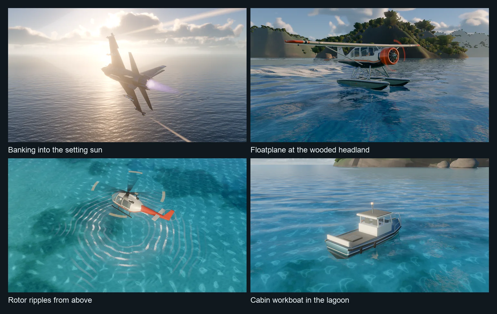
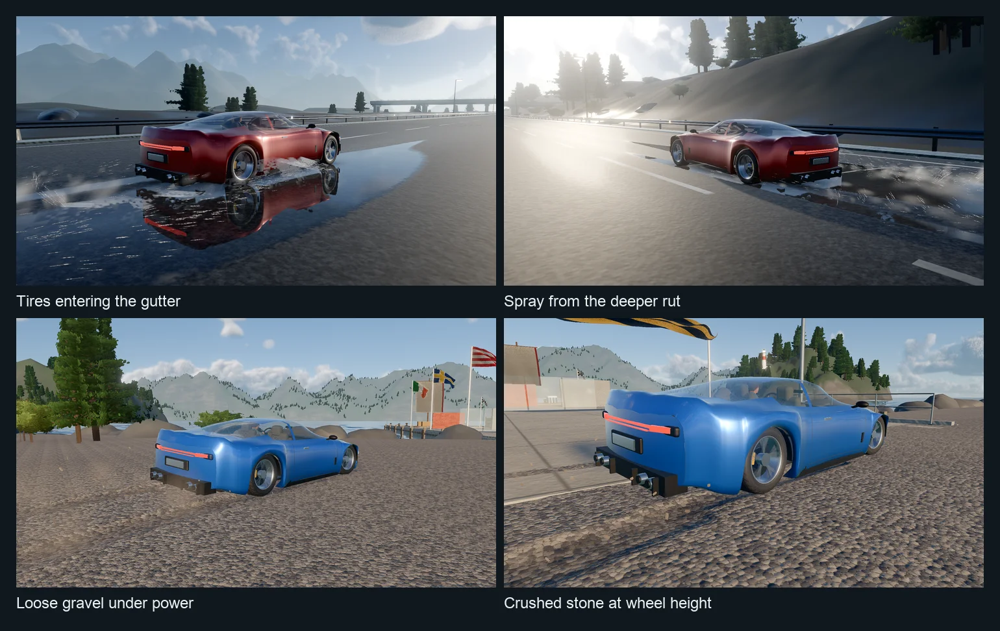
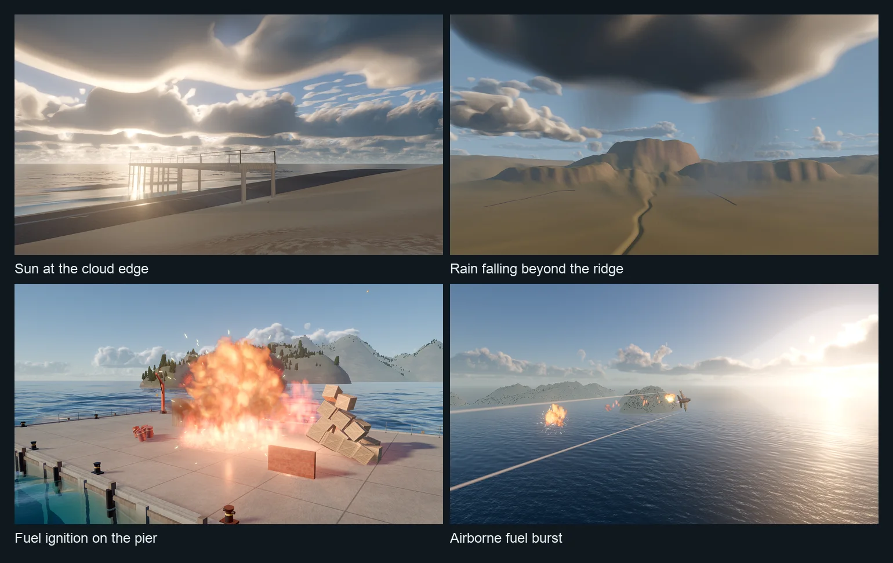
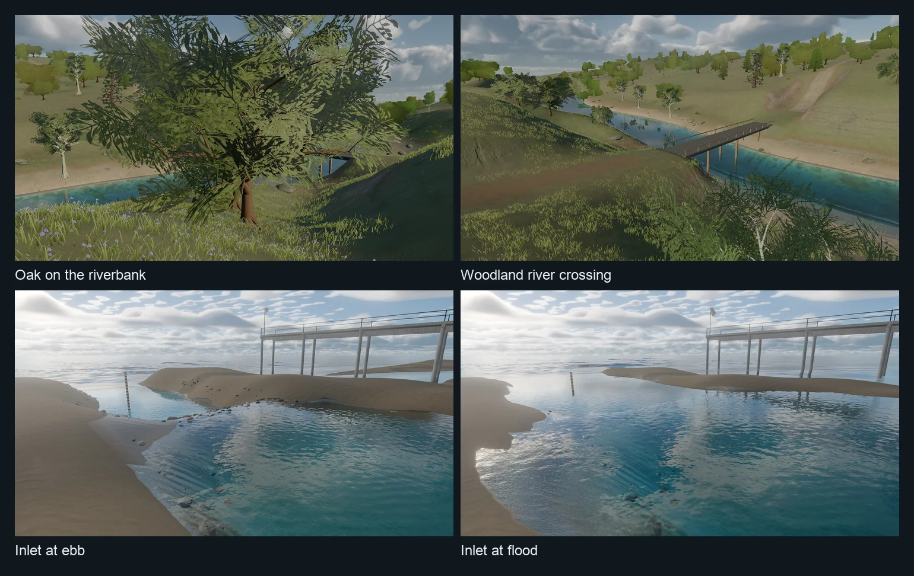

# Lumina Physics in game

Browse the highlights below, or download the [80-image offline gallery](https://github.com/LuminaBench/lumina-physics/releases/download/v1.0.0/lumina-physics-v1.0.0-gallery.zip) and open `index.html`. The frames come from playable Three.js scenes. Run `npm run preview` in the repository and use the scene selector or the field guide to explore them.

## Flight and water

Choose **Jet** for nozzle heat, wingtip vapor and cloud passes. In **Lagoon**, switch to the floatplane or select **Hover over water**. The rotor disturbs the wave surface and throws spray from the rim. [Flight and rotor controls](../../specs/07-aero.md) · [Buoyancy and wakes](../../specs/04-interaction-wakes-buoyancy.md)

## Wheel contact

In **Highway**, the water depth under each wheel sets the width of the splash. A loaded tread keeps shedding droplets as the car leaves the puddle. In **Playground**, gravel throws coarse chips and a veil of dust. [Tire spray and aquaplaning](../../specs/05-wet-road-aquaplaning.md) · [Ground deformation](../../specs/13-surface-deform.md)

## Sky, weather and fire

Try a passing shower in **Dry Lake**. Use **Fire** for a ground ignition, **Vehicle fuel burst** in **Highway**, or **Airframe fuel burst** in **Jet**. The moving emitters supply the initial velocity of the fuel cloud. [Storms and clouds](../../specs/06-atmosphere-clouds-lightning.md) · [Fire presets and controls](../../specs/08-fire-explosions.md)

## Woodland and coast

The **Landscape field guide** lets you walk, drive or fly through nine environments. Each game can define its own tree branches, flowers, ground cover and seasonal palette. [Tree shapes across detail distances](field-trees.webp) · [Eight art directions](eight-directions.webp) · [Dune cross-sections](sand-sections.webp) · [Sunlight through midnight](field-clock.webp) · [Build a coastal habitat](../../specs/27-coastal-worlds.md)
