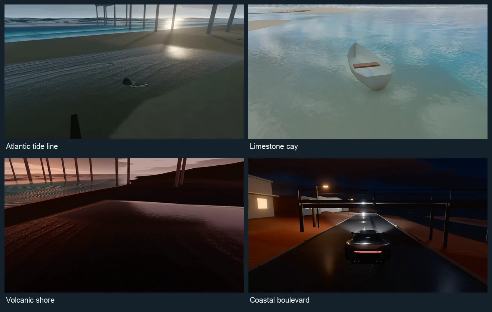
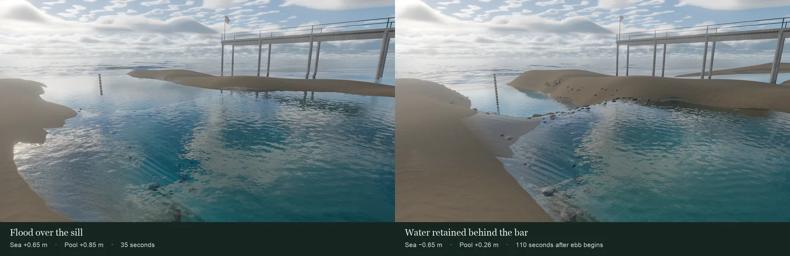
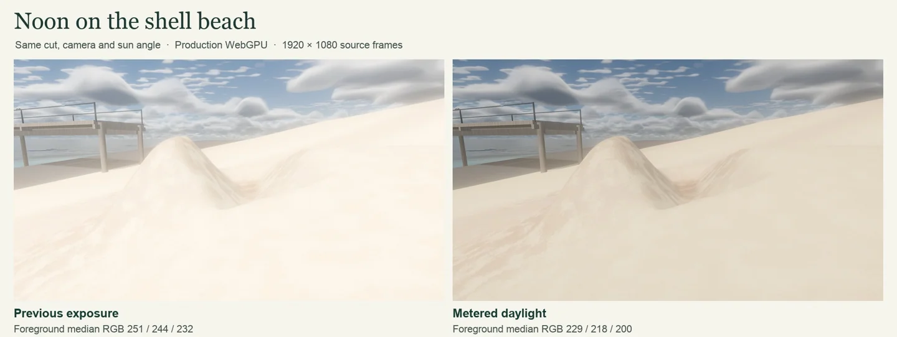
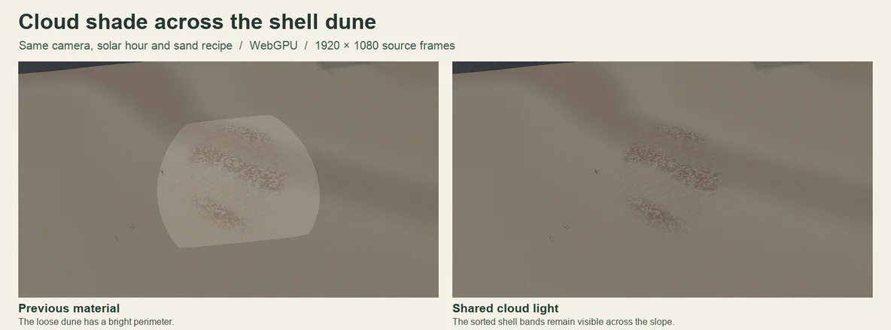
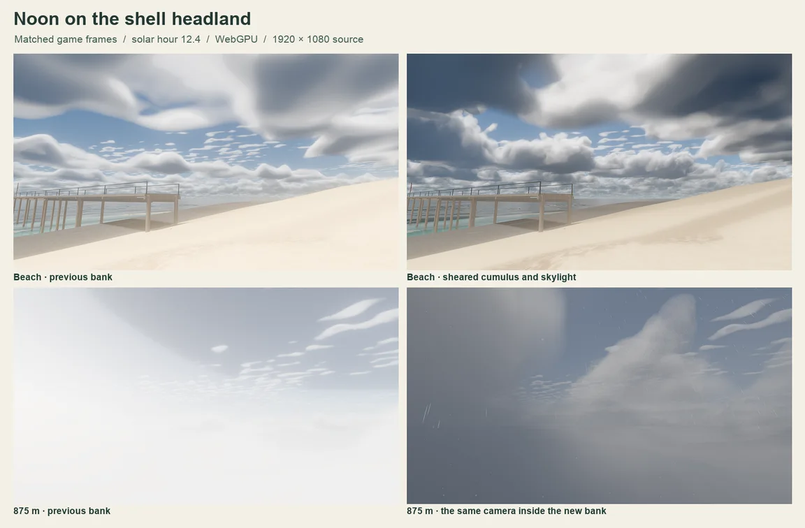
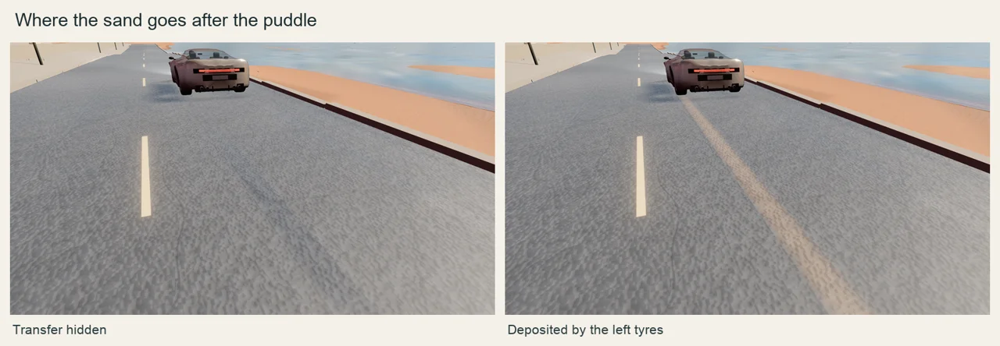
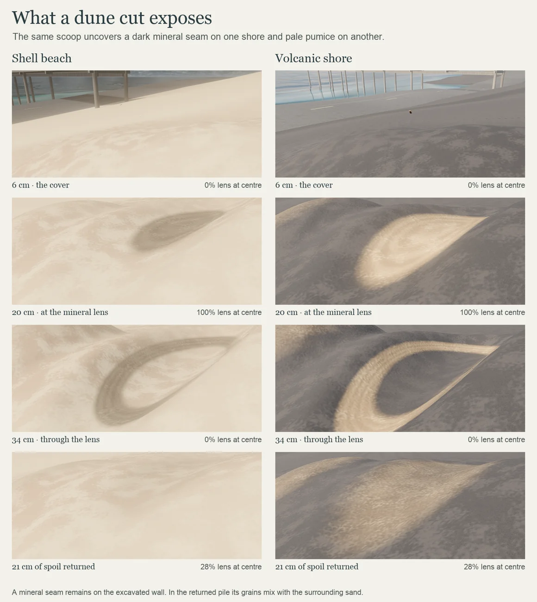

# Playable coasts in v1.0.0

Open **World profiles → Coastal field guide** in the local preview, or open `/coast.html` directly. Select a coast, then choose **Walk**, **Drive** or **Fly**. The limestone cay also has a motorised skiff. **Replay** restarts the current route. **Inspect conditions** reports what last wetted the ground, local rain and which cloud layer is attenuating sunlight. The driving view also reports the front-left wheel’s water pickup. [Controls, units and game-owned recipes](../27-coastal-worlds.md)

## What the water actually does

On the Atlantic beach, a rising sheet crossed three bootprints at two tide settings. The first print began 30.0 mm deep and ended 1.1–1.7 mm deep. The middle began 32.8 mm deep and retained 18.1–21.8 mm. The highest stayed 32.9 mm deep. The small stone at the middle print protected its downstream edge. At samples on either side of the stone, the lee side retained its 17.6 mm of relief while the exposed side fell from 26.7 mm to 15.6–18.7 mm. The save restored the relief to the nearest millimetre.

Across Atlantic and volcanic fixtures, the two renderers each returned 3,072 samples of water offset and local weather. The water offset differed from the CPU query by at most 4.5 mm. All samples more than 1 cm from the shoreline boundary agreed on wet or dry. Use a local detail window for a small rock, a host-supplied barrier for an embankment, and planting exclusions to keep vegetation clear of a road or bridge.

The limestone flight crossed the 590–1940 m lower layer and reached clear air above it. This checks cloud occupancy along the playable path. Contrast and framing are visible in the matched pictures. The noon clouds still have softer internal shadows than the low-sun coast. [Four matched camera pairs](../../docs/gallery/coastal-comparison.webp) · [One scene in three art directions](../../docs/gallery/coastal-directions.webp)

## A shingle inlet on a reversing tide

The 48 × 16.2 m surveyed patch has a shallow bar between the ocean and a deeper pool. A +0.65 m sea admitted water over the bar and refloated a loose branch. At 35 seconds the inner gauge read +0.85 m during the transient. After 110 seconds at −0.65 m outside, the inner gauge still read +0.26 m. Both readings are world elevations. The 70 kg loaded skiff floated inside and its propeller raised approximately 8 grams of existing bed mineral during three seconds of thrust. The two web renderers compared 96 waterline, current and concentration samples at each stage.

In the 1920 × 1080 skiff replay, all ten backend and tier combinations recorded 60.0 fps rounded over 180 intervals, with p95 at or below 16.8 ms on the test machine. Final internal scale ranged from 0.65 to 1.00. High used full scale on both backends. Reproduce with `npm run qa -- headland-inlet tidal-inlet` and `npm run qa -- coast-scenes.spec -g "skiff inlet"`. Use `node qa/coast-films.mjs http://localhost:4173 qa/output/inlet-film tidal-inlet` for the flood and ebb at gameplay speed.

## Two independent uses

**Salt Crossing** is a separate, playable estuary game. An author adapted the reeds to grow three seed heads and moved sunset from 20:07 to 21:25. Its 519 deterministic plant placements, host-owned bridge collider and saved delivery remained usable. At a 9 mm pool the left wheels carried film onto the bridge while the right side stayed dry. At the same instant a gauge on the far bank read 0.67 rain and the player's gauge read zero. [Source and captures](../../examples/salt-crossing)

An inland game installed just the sediment recipe and its dependencies. After the same rain and a twisting foot contact, river silt, red dirt and gravel retained different amounts of surface film. Their depressions measured 47.8, 43.4 and 40.5 mm. All three survived save and reload. [Inland recipe](../../examples/coast/inland-track.ts)

## Measured playback

### Noon on the shell beach

At a solar elevation of 53.93°, the camera walks up to a freshly cut dune. On High at 1920 × 1080, the foreground median changed from sRGB 251/244/232 to 229/218/200 on both WebGPU and WebGL 2. With unchanged scene lighting, an 18% diffuse card in full sun moved from 191/185/178 to 150/144/136. Under the timber test canopy the settled card measured 113/115/120. At a solar elevation of −6.04° its open-sky reading remained 2/3/7. These are display values for the fixed camera, clock and material.

Run `npm run qa -- headland-daylight cloud-transmission` to regenerate the six views per backend, the linear card samples and the exposure trace. The ground cloud-transmission check compares 521 receivers per renderer against a float shader readback.

### Mineral faces on shell sand

Open **Inspect conditions → Inspect sand grains** on the shell headland. The camera moves to a 31 cm eye height at the dune and faces the grains opposite the current sun. The mineral highlights slider changes exposed area. Walk or turn in this view, or press the same button again to stand.

On WebGPU and WebGL 2 the isolated face finish produced rare glints at close range. The standard deviation of added linear luminance was approximately 0.046 across a 14 cm field of view and below 0.000001 across a 4 m field of view. On a flat sample facing the light, the mean response at 0.8 m was 0.0087, close to the distant 0.0079. The same comparison before variance filtering measured 0.0750 and 0.0291. These measurements use a fixed directional light and a coarser, 19%-exposed test specimen. The pictured playable dune uses the shell recipe. Reproduce with `npm run qa -- mineral-facets` on a production preview.

### Noon cumulus from the beach and the air

The headland recipe uses a crown displacement of +520 m along X and −210 m along Z, billow shaping at 0.88 and a 125 m overhead skylight reach. The inspector can reverse the lean and change the skylight distance independently. At a fixed solar hour of 12.4 the new bank casts a deeper local shadow on the shell beach. The second pair shows the resulting cloud at a fixed 875 m observer elevation. These pictures compare two different three-dimensional density fields. To isolate illumination alone, the optical test freezes the density and changes only the skylight reach.

On the development Mac, the ten headland walk combinations at 1920 × 1080 output returned about 60.0 fps over 180 intervals each. The highest p95 was 16.8 ms. Final internal render scale ranged from 0.65 to 1.00. Each backend compared 1,344 CPU and shader density samples from two sheared layers. With cloud shape fixed, skylight changed the radiance but left all 7,680 sampled ray transmittances unchanged. Reproduce with `npm run qa -- cloud-banks cloud-transmission` and `npm run qa -- coast-scenes.spec -g "walk headland"`. Record the moving aircraft with `node qa/coast-films.mjs http://localhost:4173 qa/output/bank-film noon-cloud-flight`.

### Sand carried onto asphalt

Choose **Rain-cleared boulevard → Drive → Scatter washed sand → Replay**. The trough follows the left tires. Each can retain up to 45 g of fine and coarse grains. The inspector shows the front-left wheel’s two masses and its groove water in millimetres. The right wheels pass beside the source and stay clean. [Units, deck selection and save format](../05-wet-road-aquaplaning.md#finite-sand-carried-by-tires)

In the 1920 × 1080 High fixture, both left tires reached 45 g and both right tires retained zero. After emerging past the source, the two left tires deposited approximately 54 g of fines and 6 g of coarser grains on the exit. The mass difference after accounting for bed, tires and export was below one nanogram. Hiding only the new deposits in the frozen frame reduced the median red display value by about 40 levels across 26 samples along the driven path. Across the two renderers and five tiers, the boulevard with grit enabled recorded 60.00–60.00 fps with p95 at most 16.8 ms on the development Mac. Run `npm run qa -- grit-apron wheel-grit` on a production preview. Record the crossing with `node qa/coast-films.mjs http://localhost:4173 qa/output/grit-film sand-on-asphalt`.

### Recorded performance matrix

Production Chromium at 1920 × 1080 output on the development Apple M6 with 12 GPU cores. The original showcase, landscapes and field guide cover 174 cases. The 30 coastal cases add three moving routes across both backends and all five tiers. The coastal gate requires actual camera travel, at least 58 fps and a p95 interval of 18.5 ms or less. The interactive suite also exercises the selectable shore, clock, tide, art direction, controls and inspector. Engine-specific timing on another device requires a separate run.

| Suite | Cases | Average fps across cases | Highest p95 |
| --- | ---: | ---: | ---: |
| Original showcase · WebGPU | 40 | 59.51–60.16 | 16.8 ms |
| Original showcase · WebGL 2 | 40 | 59.29–60.16 | 16.8 ms |
| Original landscapes · WebGPU | 30 | 60.00–60.00 | 16.8 ms |
| Original landscapes · WebGL 2 | 30 | 59.67–60.00 | 16.8 ms |
| Landscape field guide · WebGPU | 17 | 60.00–60.00 | 16.8 ms |
| Landscape field guide · WebGL 2 | 17 | 59.67–60.00 | 16.8 ms |
| Playable coasts · WebGPU | 15 | 60.00–60.00 | 16.8 ms |
| Playable coasts · WebGL 2 | 15 | 60.00–60.00 | 16.8 ms |

| Coastal routes | First observed usable frame | First accepted clock input | Internal scale | Longest sampled frame |
| --- | ---: | ---: | ---: | ---: |
| WebGPU | 1.66–5.41 s | 2.58–7.11 s | 0.65–1.00× | 16.8 ms |
| WebGL 2 | 6.74–11.18 s | 6.89–11.21 s | 0.65–1.00× | 16.8 ms |

Two WebGL 2 playground runs sustained 60.09 and 60.13 fps with zero missed refreshes but exceeded the separate 2.50 ms simulation allowance (2.501 ms High, 2.569 ms Ultra). An isolated repeat on the same build measured 2.393 and 2.232 ms and passed both gates. The table retains the original batch timing.

Each route uses a fresh page context. Browser, OS and driver caches may remain warm. Coastal frame intervals cover 180 samples after warm-up. First input includes Playwright focusing the solar slider, changing its value and waiting for the next frame. This measurement includes startup and automation overhead. [Thirty per-route measurements](v1.0.0-coast-measurements.csv)

A separate 600.01 s High WebGPU drive measured 59.52 fps over 3.80 km and 35 laps. The car spent 9,221 sampled frames on the road and 26,489 on sand. It completed the route with zero automatic resets and two frame intervals over 50 ms. Its starting impression still measured 21.77 mm on return. The save occupied 579,224 bytes. Ten-second samples peaked at 384 sediment tiles, 370 spray instances and 78 mist instances, with 84 geometries and 74 textures. Chromium reported a quantised 157 MB JavaScript heap throughout those samples. The drive measured the coastal physics before the final exposure, sky drift and view-transition adjustments.

## Sand sections on two shores

In **Coastal field guide → Inspect conditions**, both **Shell beach below the headland** and **Volcanic shore** support the same excavation controls. After a 6 cm skim the centre still consists of matrix sand. At a total cut depth of 20 cm it exposes the lens. At 34 cm the centre passes below the lens and the curved seam remains on the walls. Returning 21 cm of excavated spoil puts a mixture with about 28% lens grains back at the centre.

At the headland, reaching the dark seam reduced the mean display RGB value by about 46 levels at the projected sample points on an 8-bit scale. The same cut increased it by about 64 levels on the pale volcanic seam. A separate contact check prepared 45 mm of cover over both samples. A shallow sole removed 9.1 mm and left the cover intact. Two loaded wheel contacts displaced 74.8 mm and exposed the layer.

Across both shores, five tiers and both renderers, the 20 warmed 1920×1080 runs on the development Mac averaged 60.00 fps at internal scales of 0.65–1.00. Each three-second window included 36 active dune revisions. The 95th-percentile frame interval was 16.7–16.8 ms. Shader readback disagreed with the CPU surface fraction by less than 0.000007 across 101 sampled positions per shore and backend.

The standalone installer supplied the section to a separate Three.js game with a red matrix, a pale 47 mm layer, its own terrain, camera, sunlight and renderer. Its scoop and save/restore preserved 0.3740 m³ of mineral grains. The game rendered on WebGL 2 with no console or shader errors. [Layer controls, migration and integration](../27-coastal-worlds.md#buried-mineral-lenses) · [Game-owned pumice recipe](../../examples/coast/pumice-bank.ts)

## Reproduce the checks

Run `npm ci`, `npm run build` and `npm run preview` from a clone. Playwright uses a real GPU. The coastal checks are `qa/coast-scenes.spec.ts`, `qa/coastal-process.spec.ts`, `qa/coast-readback.spec.ts` and `qa/coastal-scenes-interaction.spec.ts`. The long drive is opt-in through `LUMINA_COAST_SOAK=1` with `qa/coastal-soak.spec.ts`. Generate the eight recordings with `node qa/coast-films.mjs http://localhost:4173`, substituting the address printed by the local preview. Use `node qa/coast-reference.mjs 2031913` to compare renderer revisions with the same host fixture, seed, clock and camera.

The playable reference implementation runs on Three.js WebGPU and WebGL 2. Headless Godot checks exercised the starter wave-offset and drying formulas and loaded its shader resources. Unity checks covered C# and HLSL source syntax. Native editor footage and native performance remain unmeasured.
