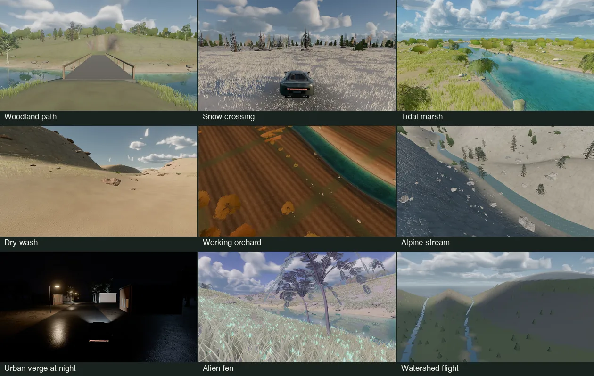
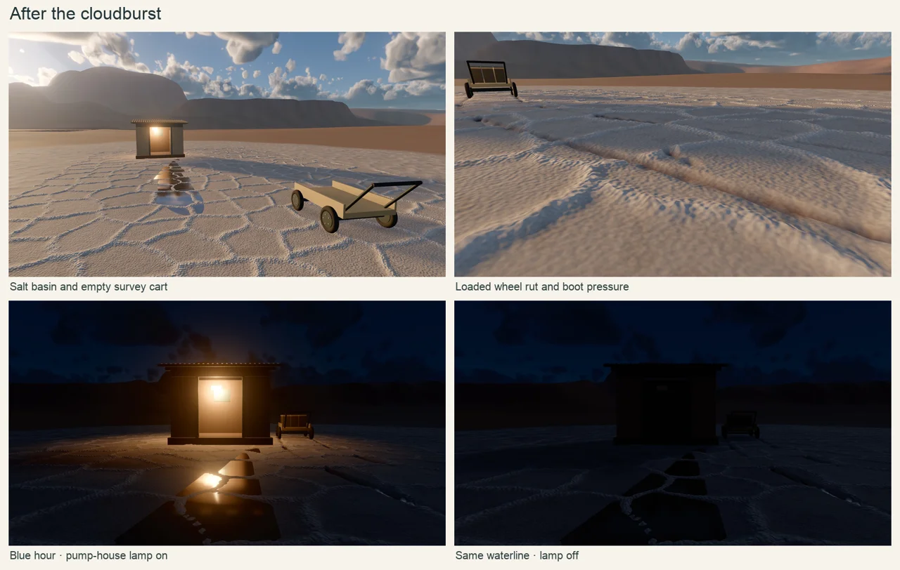
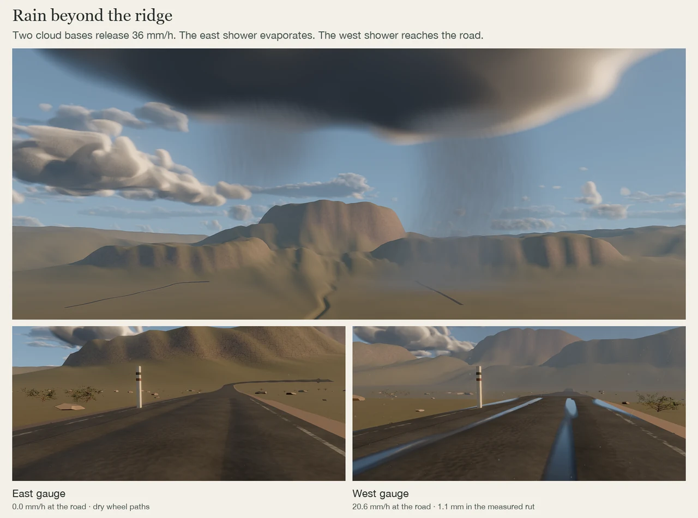
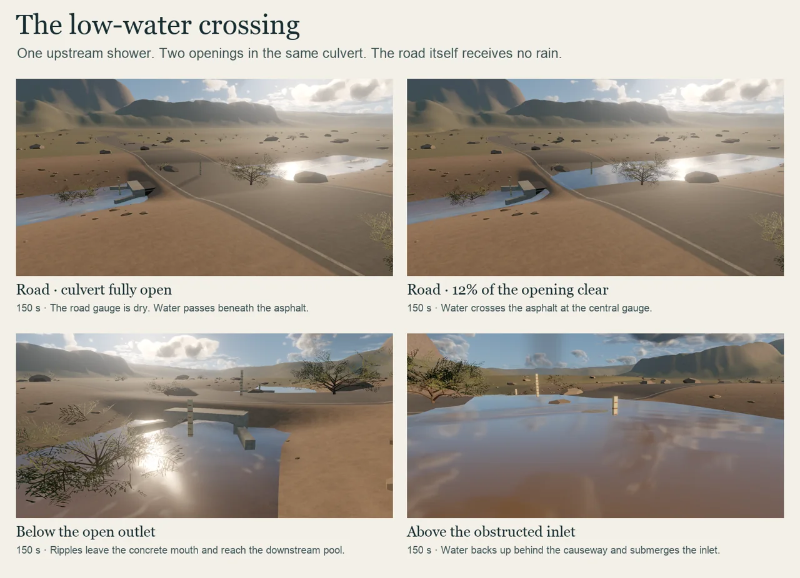

# Landscape field guide for v1.0.0

The field guide and Brindle Reach ship as playable local examples. Run `npm ci` and `npm run preview`, then choose **World profiles → Landscape field guide**. **Inspect** describes the ground, habitat and nearest plant at your position. The art direction, season and clock can change while you stand beside the same tree. [Build a project-owned recipe](../26-land-authoring.md)

| Route | What to try |
| --- | --- |
| Willow Bridge | Walk and drive the same crossing. Switch to winter and relocate the oak. |
| Thaw Lane | Drive through snow and slush. Each wheel carries its own surface film. |
| Heron Channel | Raise the tide, launch the canoe and paddle through the reed margins. |
| Dry Wash | Release a pulse upstream and follow the water down the wash. |
| Orchard Rows | Cut a strip between the rows and inspect the recovering ground. |
| Spruce Divide | Visit the meltwater stream, then climb to the exposed ridge. |
| Rain Garden Lane | Track a roof outlet through the gutter. At night, drive past a puddle under a lamp. |
| Lantern Fen | Change the art direction while retaining the same alien plants and walkable ground. |
| Two Rivers Flight | Follow a river through a mountain divide and return to the takeoff landmark. |

## Edit a game after the first prompt

Brindle Reach began in an empty project with an installed copy of the skill. Its author grew a wind-shaped Cindercomb, placed blue Vesper cups in sheltered hollows, painted the leaves and built a clay crossing. The follow-up changed the cup from five flutes to eight. Both revisions place 164 flowers, and their heads use 184 and 256 triangles respectively. The project keeps its own source beside the managed library. A selective module update preserved all eight original game source files. [Project code](../../examples/brindle-reach) · [Compare the flowers and crossing](../../docs/gallery/project-grown-valley.webp)

The separate host test attaches to a scene with its own camera rig, lights, renderer, heightmap and Rapier bridge collider. It excludes the road from planting, samples all four tires and checks a real raycast against the deck before and after teardown. The contact tests also cover snow compression, soil drying, downhill water transport, matching drawn and sampled meltwater height, and a stream outlet reaching neighboring cells.

## Visual comparisons

These are frames from the renderer. The eight art directions share a camera, solar hour and terrain seed, so even the daytime noir comparison keeps the sunlight in place. The clock sequence moves continuously from 15:00 to midnight. The camera holds the crossing while the sky, foliage, ground and reflection change. [Eight directions](../../docs/gallery/eight-directions.webp) · [Solar clock animation](../../docs/gallery/field-clock.webp)

The grayscale tree study follows the same four planted IDs from their near geometry to their far crown projections. The willow retains its hanging outline and the spruce its narrow tiers. The far oak and birch lose smaller gaps between their branches, especially against a wooded hillside. The regional flight uses coarser vegetation and terrain than the walkable valley. [Near and far tree study](../../docs/gallery/field-trees.webp)

On the slate headland, detached fragments settle below the fractured face. In a fixed-light comparison the central rock sample darkened from about 80 to 60 on an 8-bit luminance scale when wetted, on both renderers. The second pair follows a moving car through a reflected streetlamp at night. [Wet slate and moving headlights](../../docs/gallery/field-surfaces.webp)

## A salt flat after a cloudburst

Open **Landscape field guide → Salt basin** for the original [playable field study](../../examples/dry-lake/README.md). Its guided cart follows the same 11.4 m path with an empty rack or a selectable ballast. On the development Mac, the 29 kg cart left the crust intact. With 180 kg added, the surface beneath one wheel changed from +41.6 mm to +6.9 mm at the same world coordinate. The host’s maintained brine level is +9 mm. A separate boot contact broke about 74% of the local crust at its inspection point. Both renderers restored the sampled rut and boot height after reloading the survey.

At solar hour 19.2, the test sampled 406 submerged positions in the pool facing the pump house. Switching off the practical lamp reduced the mean red display value there by about 91–92 levels. With the lamp still on, disabling only the box-projected local reflection reduced the same mean by about 66 levels. The route crosses from matte salt to wet clay and shallow brine under a shared sky. These display comparisons quantify the selected scene and camera.

The ten 1080p cart runs on the development Mac averaged 60.00–60.01 fps across five tiers on WebGPU and WebGL 2. Over 180 frame intervals per run, the 95th percentile was 16.7–16.8 ms at internal scales of 0.65–1.00. The first cart motion appeared 0.54–0.71 seconds after navigation.

The standalone installer also supplied the salt surface to a separate host with a sloped mud bed, a different mask, a 9 mm crust, a different palette and a narrower contact. Its saved surface restored the compressed height of 14.9 mm from an undisturbed 40.2 mm. [Authoring controls and save validation](../13-surface-deform.md#salt-plates-over-mud)

## Rain beyond the ridge

The two desert showers both start at 36 mm/h. The east gauge remained at zero under the dry lower air. The west gauge received 20.6 mm/h and about 65 litres reached its 93.6 m² asphalt catchment during the two-minute observation and short live lead-in. The water reached 1.1 mm at the measured wheel rut. Increasing the humidity on the east side made its own road collect rain. Emptying that catchment with the camera and humidity held fixed changed the mean absolute blue-channel reading across 541 projected wet positions by 73–74 display levels on the two renderers. [Try both gauges](../../examples/dry-lake/README.md#rain-beyond-the-ridge)

In the ridge view, hiding just the two shafts changed the mean absolute RGB value by about 29 levels at 320 m altitude in the east shower and 35 levels at 155 m in the west shower. The sample at 95 m beneath the east shower changed by less than one level. These are rendered pixel comparisons at the sampled locations, with identical camera and solar settings. [Rainfall model, rendering and installation](../06-atmosphere-clouds-lightning.md#rain-shafts-and-virga)

The ten production rain-survey runs averaged 60.00 fps at 1920 × 1080 output on the development Mac below. Across Low through Ultra on WebGPU and WebGL 2 the p95 frame interval was 16.7–16.8 ms, the internal scale was 0.65–1.00, and each run measured 180 intervals with surface water accumulating. An independent coastal game installed the new module, changed the cloud rate to 48 mm/h and supplied its own terrain and camera. With its viewer at 330 m the local streak factor was 0.92 while the ground remained dry. Raising lower-air humidity to 96% delivered about 36.2 mm/h at the same ground position.

## Measured playback

Chromium on an Apple M6 with 12 GPU cores, macOS 27.2.1, at 1920 × 1080 output. Each route opens in a fresh browser context. Driver and operating-system caches can remain warm. Field routes use 180 frame intervals after warm-up. The five quality tiers use an internal scale of 0.65–1.00. A field-guide driving case passes only after the vehicle moves above 2 m/s.

| Production suite | Cases | Average fps by case | p95 frame | First usable |
| --- | ---: | ---: | ---: | ---: |
| Original showcase, WebGPU | 40 | 60.07–60.13 | 16.7–16.8 ms | 1.12–3.16 s |
| Original showcase, WebGL 2 | 40 | 60.07–60.14 | 16.7–16.8 ms | 1.34–6.91 s |
| Original landscapes, WebGPU | 30 | 60.00 | 16.7–16.8 ms | 0.79–1.24 s |
| Original landscapes, WebGL 2 | 30 | 59.67–60.00 | 16.7–16.8 ms | 0.97–4.33 s |
| Field guide, WebGPU | 17 | 60.00–60.01 | 16.7–16.8 ms | 0.98–3.10 s |
| Field guide, WebGL 2 | 17 | 59.67–60.00 | 16.7–16.8 ms | 1.21–4.57 s |

The 34 field runs cover every family and art direction on both backends, two additional regional recipes, the project chalk stream and the wooded drive at all five tiers. Measured first input was 1.08–3.15 s on WebGPU and 1.26–4.61 s on WebGL 2. Field p99 was 16.8 ms throughout. One WebGL 2 run had a 33.4 ms interval. The largest sampled JavaScript heap was 199 MB on both backends. Regional flight held at most 25 tiles. The heap sample excludes driver allocations and GPU memory. [Per-route measurements](v1.0.0-field-measurements.csv)

The first field run missed the 58 fps floor on four winter and urban routes (48.00–53.73 fps), and the first woodland test accepted a stationary car. After correcting the crossing and requiring actual movement, six cases still missed (53.73–57.14 fps). Preparing the same foliage vertex layout at startup that the renderer uses on the road removed the mid-drive compilation stalls in the affected checks. The original three-landscape suite also had two first-pass misses at 57.14 fps on the Low tire-height dry highlands, one per backend. The full 60-case rerun passed. The two affected cases measured 60.00 fps on WebGPU and 59.67 fps on WebGL 2.

The reference renderer and browser interaction checks cover Three.js WebGPU and WebGL 2. Godot starter checks cover GDScript, profile decoding and shader resources. Unity checks cover C# and shader source syntax. Native editor rendering and frame rates were outside these measurements. [Engine coverage by subsystem](../26-land-authoring.md#engine-coverage)

## A low-water crossing after upstream rain

In the [playable storm survey](../../examples/dry-lake/README.md#low-water-crossing), the road receives no local rain. Three headwater bands receive 33.87 m³ of rain, of which 4.30 m³ goes into the soil. The last one-second upstream gauge reading over 0.01 mm/h occurs at 50 seconds. Routed inflow first exceeds 1 L/s at 61 seconds.

| Culvert opening | Peak depth at the road | Time above 5 mm starts | Water stored locally at 270 s | Volume discharged by 270 s |
| --- | ---: | ---: | ---: | ---: |
| 100% | 0 cm | Road remains dry | 1.41 m³ | 28.16 m³ |
| 12% | 4.34 cm at 153 s | 131 s | 11.91 m³ | 17.66 m³ |

Saving at 108 seconds and resuming through 270 seconds reproduced the full stored water, momentum and sediment arrays in both storms. In the browser, restoring the 105-second storm reproduced the measured hydrograph at 150 seconds. At that time, 626 road samples with over 18 mm of water in the obstructed run changed by an average absolute 36.6–37.3 RGB levels on an 8-bit scale between the two rendered crossings. The camera and storm time matched across each open/obstructed pair.

The ten crossing runs on the development Mac covered all five quality tiers at 1920×1080 output on WebGPU and WebGL 2. During 180 measured intervals around the moving crest, mean frame rate was 60.00 fps, p95 was 16.7–16.8 ms, and reported internal scale was 0.65–1.00. Browser interaction checks observed zero console and shader errors. A fresh Three.js game installed only the crossing module, reversed the survey direction, supplied its own rainfall profile and reproduced its outlet volume after reloading. [Model, limits and units](../28-runoff-crossing.md)
